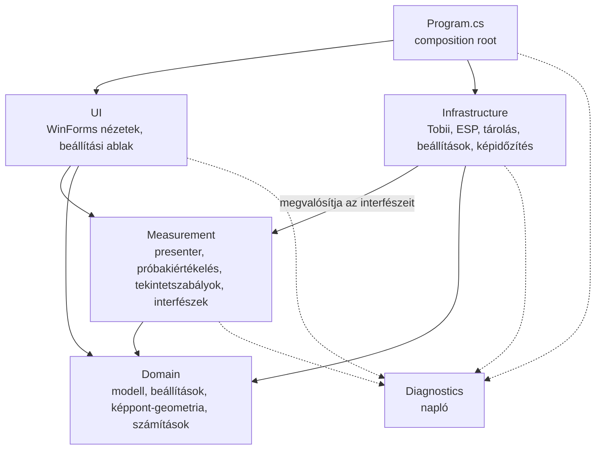
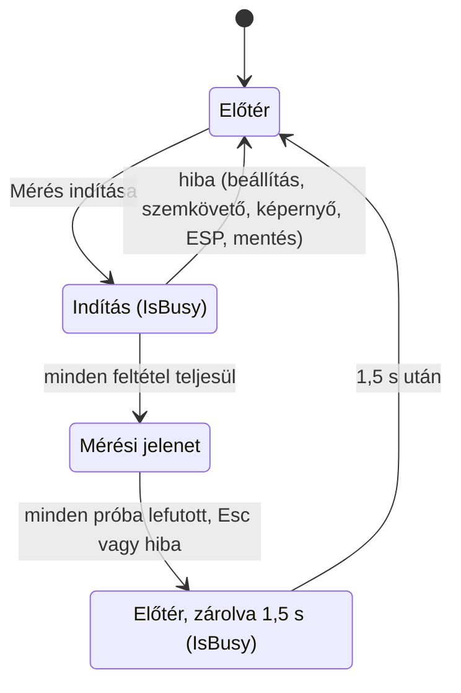
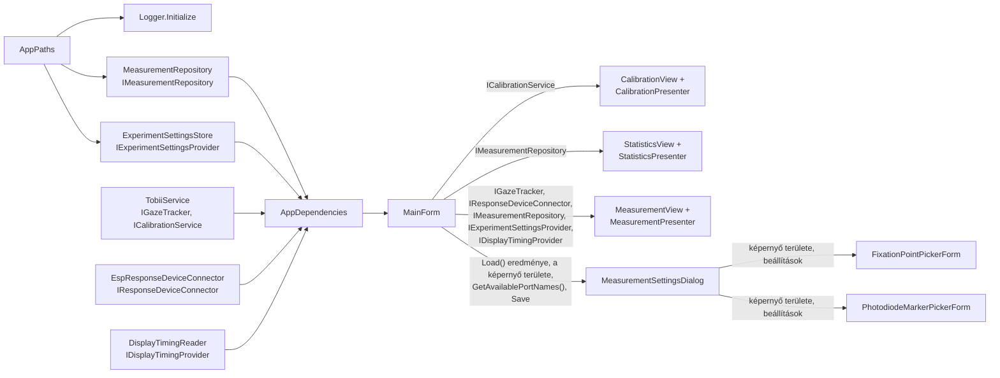

# Fejlesztői dokumentáció

A leírás a program 2.0.0-s verziójára vonatkozik (`ReactionTimeMeasurementApp.csproj`,
`<Version>`). A használt fogalmak (mérőfelület, előtér, mérési jelenet,
tekintet-ellenőrzés, válaszablak) magyarázata:
[FELHASZNALOI_UTMUTATO.md](FELHASZNALOI_UTMUTATO.md#fogalmak).

## 1. Rétegek

A mappák a névtereknek felelnek meg (`ReactionTimeMeasurementApp.<Mappa>`).



A szaggatott nyilak a naplózást jelölik: a statikus `Logger`-t a Domain
kivételével minden réteg használja.

| Réteg | Felelősség | Nem függ tőle |
|---|---|---|
| **Domain** | eredmények (`MeasurementResult`, `MeasurementSessionResult`, `ReactionTimeSummary`, `TrialInvalidReason`, `ReactionTimeLimits`), beállítások (`ExperimentSettings` a szakaszaival és felsorolásaival, `SettingsLimits`, `SettingsIssue`, `HexColor`), próbaterv (`TrialSchedule`, `ForeperiodSampler`), a mérőfelület geometriája (`StageLayout`, `PhotodiodeMarker`, `FixationCross`, `StimulusPlacement`, `StageFeasibility`, `GazeAcceptance`), scanout-képlet (`ScanoutTrialParameters`, `ScanoutGeometry`, `DisplayTiming`), tekintetfelvétel (`TrialGazeRecording`), `MeasurementSetupException` | WinForms, hardver, fájlrendszer, napló |
| **Measurement** | a mérés menete (`MeasurementPresenter`, a próbák futtatása: `TrialRunner`, a geometria rögzítése: `SessionGeometryBuilder`), a kalibráció és a statisztika presentere (`CalibrationPresenter`, `StatisticsPresenter` a nézetinterfészeikkel, `ResultDisplayText`), a futó mérés pillanatképe (`SessionContext`, `SessionGeometry`), a próba érvényessége (`TrialEvaluator`), a metaadatok (`SessionMetadata`), az előtér szövegei (`LobbyText`), a nézet szerződése (`IMeasurementView`, `StageInfo`, `MeasurementScene`, `MeasurementViewState`), a tekintetszabályok (`IGazeValidationRule`, `GazeValidationRules`), a külső függőségek interfészei (`Abstractions.cs`, benne a `SettingsLoadResult`) | WinForms, konkrét hardver |
| **Infrastructure** | `TobiiService` + `TobiiCalibrationLauncher`, `EspResponseDevice(Connector)` + `Serial` + `SerialPortConnection` + `EspPortFinder`, `MeasurementRepository` + `MeasurementSessionWriter`, `ExperimentSettingsStore`, `DisplayTimingReader`, `AppPaths`, `AppOptions` | UI |
| **UI** | `MainForm`, `MenuView`, `CalibrationView`, `MeasurementView`, `StatisticsView`, `MeasurementSettingsDialog` (+ `SettingsPreviewPanel`), a kijelölők (`StagePickerFormBase`, `FixationPointPickerForm`, `PhotodiodeMarkerPickerForm`), `ViewTransition`, `ErrorPopup`, és a rajzolási segédek (`StagePainter`, `UiTheme`, `BufferedPanel`, `UiRedrawScope`, `ViewBackgroundStyler`, `UiResourceCache`, `CircleIndicator`, `ControlExtensions`, `MeasurementDisplayText`) | Infrastructure, `System.IO.Ports` |
| **Diagnostics** | `Logger` | – |

A Measurement réteg a WinForms-típusok közül semmit nem használ; a
`System.Drawing` értéktípusai (`Color`, `Point(F)`, `Rectangle(F)`, `Size`)
megengedettek. A UI a soros portokat sem közvetlenül kérdezi le: a portlistát
az `IResponseDeviceConnector.GetAvailablePortNames()` adja.

A repó a programon kívül az ESP firmware-ét is tartalmazza (`firmware/`,
ESP-IDF projekt, C); leírása a [README](../README.md#firmware-és-hardver)-ben
és a [SCANOUT_PROTOCOL.md](SCANOUT_PROTOCOL.md)-ben van.

## 2. MVP

Az MVP (Model–View–Presenter) mintát minden nézet követi, amely
szolgáltatást hív vagy döntést hoz:

| Nézet (UI) | Nézetinterfész | Presenter (Measurement) | Szolgáltatás |
|---|---|---|---|
| `MeasurementView` | `IMeasurementView` | `MeasurementPresenter` (+ `TrialRunner`) | szemkövető, ESP, tárolás, beállítások, képidőzítés |
| `CalibrationView` | `ICalibrationView` | `CalibrationPresenter` | `ICalibrationService` |
| `StatisticsView` | `IStatisticsView` | `StatisticsPresenter` | `IMeasurementRepository` |
| `MeasurementSettingsDialog` | lásd [A beállítási ablak](#a-beállítási-ablak) | | `IExperimentSettingsProvider` |

A presenterek WinForms nélkül, hamis nézettel és szolgáltatásokkal is
futtathatók. A navigációt (melyik nézet látszik) és a kalibráció
megerősítésének tényét a `MainForm` kezeli: a `CalibrationPresenter`
`CalibrationConfirmed` eseményére jegyzi meg, és a mérés megnyitásakor ebből
dönti el, kell-e még kalibráció.

A statisztika presentere a mentett méréseket egyszer, háttérszálon olvassa be
(`LoadAsync`), az alkalmazás futása alatt befejezett méréseket pedig a
memóriából veszi fel (`AddSession`). A beolvashatatlan fájlokat
(`MeasurementLoadResult.UnreadableFiles`) és a kihagyott hibás sorokat
(`MeasurementSessionResult.SkippedRowCount`) a nézet jelzi, így egy hibás fájl
nem tűnik el csendben. A próbánkénti PC − ESP különbség
(`MeasurementResult.LocalMinusEspMs`) és összesítése
(`MeasurementSessionResult.DifferenceSummary`) a Domain rétegben van.

A mérés a **passzív nézet** változatot követi:

- A `MeasurementView` (UI) csak megjelenít és eseményeket továbbít
  (`StartRequested`, `LeaveRequested`, `AbortRequested`, `ResponseClicked`,
  `Closed`). Nem hoz döntést.
- A `MeasurementPresenter` (Measurement) minden döntést meghoz. Kiszámolja a
  nézet teljes állapotát (`MeasurementViewState`), és az `ApplyState`-tel
  átadja. Az ingert a `ShowStimulus` mutatja meg.

A presenter a mérés menetét vezérli; a tőle független részek külön, tiszta
(csak a paramétereikből dolgozó) osztályokban vannak:

| Osztály | Feladat |
|---|---|
| `SessionContext`, `SessionGeometry` | a futó mérés változatlan pillanatképe (lásd lent) |
| `TrialEvaluator` | egy próba érvényességének eldöntése (`DetermineInvalidReason`) |
| `SessionMetadata` | a mérési fájl metaadatainak összeállítása, rögzített sorrendben |
| `LobbyText` | az előtér szövegei: instrukció, összefoglaló, az előző mérés kimenetele (`LastSessionSummary`) |

A nézet két állapotban van:

- **Előtér** (`IsRunning = false`): az alkalmazás rögzített háttere (nem a
  beállított mérési háttér), középen egy kártya a résztvevőnek szóló
  instrukcióval (`InstructionText`), az előző mérés kimenetelével
  (`StatusText`), a kutatónak szóló összefoglalóval vagy a beállítási hibával
  (`SettingsSummaryText`), valamint a „Mérés indítása” (`StartButtonText`) és a
  „Vissza a menühöz” gombbal. A fotodióda-jelző itt is fekete, körülötte egy
  1 képpontos szürke keret segíti az érzékelő felhelyezését.
- **Mérési jelenet** (`IsRunning = true`, `Scene` kitöltve): csak a beállított
  háttér (`MeasurementScene.BackgroundColor`), a fixációs kereszt a helyén
  (`FixationPoint`), az inger (`StimulusColor`) és a fotodióda-jelző, keret
  nélkül. Szöveg nem látszik, így szövegváltozás sem eshet egybe az inger
  megjelenésével. Az egérmutató csak ingerre kattintós módban
  (`ResponseMode.ClickOnStimulus`, `MeasurementScene.ShowCursor`) látszik; a
  program nem mozgatja.

Az `IsBusy` indítás és leállítás közben, valamint a mérés vége után 1,5
másodpercig tiltja a gombokat (a válaszegér egy késve érkező kattintása ne
indítson rögtön új mérést). Az előző mérés kimenetele (`StatusText`) a nézet
elhagyásakor mindig törlődik (`LeaveAsync`), akkor is, ha a mérést épp a
visszalépés szakította meg.



A presenter két beállításpéldánnyal dolgozik:

- Az **előtér** a legutóbb betöltött beállításokat mutatja (`_lobbySettings`,
  `_lobbyRule`, `_lobbyError`). A konstruktor és a `ReloadSettings()` tölti be
  őket; a `MainForm` a nézet megjelenítése előtt és a Testreszabás mentése után
  hívja. A konstruktor a nézet helyzetét (`GetStageInfo`) nem kérdezi le, mert a
  `MainForm` a nézetet előtöltéskor hozza létre, még mielőtt a felületre kerülne.
  A `RequiresCalibration` tulajdonság ugyanezekből mondja meg, kell-e a
  beállításokhoz kalibráció (csak tekintet-ellenőrzésnél; hibás beállításoknál
  hamis).
- A **futó mérés** az indításkor újra betöltött és ellenőrzött beállítások
  saját másolatából és egy változatlan pillanatképből (`SessionContext`:
  beállítások, tekintetszabály, geometria, `GazeActive`, véletlenmag, színek)
  dolgozik. A próbák ciklusa, a kiértékelés, a metaadatok és a jelenet csak
  ebből olvas, így a beállítások közbeni újratöltése nem hat rá.

A tekintet-ellenőrzés módjai közti különbséget stratégiaobjektumok adják:
`GazeValidationRules.For(GazeValidationMode)` a `NoGazeValidationRule`,
`LookAtStimulusRule` vagy `KeepFixationRule` példányt adja. Az
`IGazeValidationRule` adja a mérés nevét (`SessionName`, ez a CSV `ModeName`
mezője), az instrukciót (`InstructionText`), azt, hogy kell-e szemkövető
(`RequiresTracker`), és a tekintet alapú döntést (`IsGazeValid`). A nézet és a
presenter minden módnál ugyanaz. Az elfogadási távolságot a szabályok és a
beállítási ablak előnézete is a `Domain.GazeAcceptance`-ből veszi, így a kettő
nem térhet el.

A presenter nem hivatkozik WinForms-típusra, és minden külső függősége
interfész (`IMeasurementView`, `IGazeTracker`, `IResponseDeviceConnector`,
`IMeasurementRepository`, `IExperimentSettingsProvider`,
`IDisplayTimingProvider`).

### A beállítási ablak

A beállítási ablak is MVP: a `SettingsEditorPresenter`
(`Measurement/SettingsEditorPresenter.cs`) tölti be a beállításokat
(`IExperimentSettingsProvider.Load`), a betöltött `ExperimentSettings` egy
másolatán dolgozik, minden módosítás után ellenőriz (`Validate`, `GetWarnings`,
`StageFeasibility`), és ő ment (`Save`). A `MeasurementSettingsDialog` modális
WinForms-ablak, passzív nézet (`ISettingsEditorView`): a vezérlők értékeit
(`SettingsEditorFields`) adja és fogadja, a presenter által kiszámolt állapotot
(`SettingsEditorViewState`: hibák, figyelmeztetések, előnézet, a függő vezérlők
állapota) megjeleníti, a felhasználói műveleteket pedig eseményként továbbítja.
A négy fül (`TrialsSettingsTab`, `AppearanceSettingsTab`, `GazeSettingsTab`,
`HardwareSettingsTab`) a közös `SettingsTab` ősből származik. A portlistát és a
kijelző fizikai méretét az ablak kész értékként kapja, így Infrastructure-
hivatkozás nélkül működik.

```csharp
// MainForm: az ablak életciklusa tartja életben a presentert (a nézet eseményeire iratkozik fel).
using var dialog = new MeasurementSettingsDialog(
    screen.Bounds,                                    // a mérést futtató képernyő (a főablak képernyője)
    _dependencies.ResponseDeviceConnector.GetAvailablePortNames(),
    _dependencies.DisplayTimingProvider.ReadPhysicalSize(screen.DeviceName));
_ = new SettingsEditorPresenter(dialog, _dependencies.SettingsProvider);
```

- A vezérlők tartománya a `SettingsLimits`-ből jön, ugyanabból, amiből a
  `Validate()` dolgozik, így egy érvényes fájl mindig megjeleníthető. Az egész
  értékű mezők kerekítése: `MidpointRounding.AwayFromZero`.
- A hibákat és figyelmeztetéseket a presenter minden változáskor egyszer
  számolja ki; a rajzolás (előnézet) nem számol. A hibák forrása a
  `Validate()` és (hibátlan beállításoknál) a
  `StageFeasibility.Evaluate(...).Errors` a mérés képernyőjének méretével; a
  figyelmeztetéseké a `GetWarnings()` és a `StageFeasibility.Warnings`. Minden
  elem `SettingsIssue(Section, Message)`: az ablak a `Section` alapján jelöli a
  hibás fület („⚠”), a szöveges alak (`ToString`) pedig az üzenet végére írja
  a fül nevét („… (Megjelenés fül)”).
- A módszertani figyelmeztetések (3:1 alatti kontraszt,
  `ExperimentSettings.MinimumContrastRatio`; ingerre kattintás periférikus
  módban; tekintet-ellenőrzés gyakorló inger nélkül) a Domainben vannak
  (`ExperimentSettings.GetWarnings()`), nem az ablakban.
- A Mentés gombnak nincs `DialogResult`-ja: a kattintás véglegesíti a
  begépelt értékeket, újra ellenőriz, ment, és csak sikeres mentés után zárja
  az ablakot `DialogResult.OK`-val. Mentési hibánál (`IOException`,
  `UnauthorizedAccessException`) az ablak nyitva marad a módosításokkal.
- A `SettingsPreviewPanel` a mérési képernyő kicsinyített modelljét és az
  ingert 1:1 képpontos méretben rajzolja. A mintainger helyét a
  `StageFeasibility.SampleStimulus` adja
  (`StimulusPlacement.FindFirstPlacement`: a legkisebb távolságban, jobbról
  indulva az első elférő irány), az elfogadási kört a
  `StageFeasibility.GetAcceptanceCircle`.
- A két kijelölő (`FixationPointPickerForm`, `PhotodiodeMarkerPickerForm`)
  közös alapja a `StagePickerFormBase`: keret nélküli, teljes képernyős ablak
  a mérés képernyőjén, a beállított háttérrel, közös billentyűkezeléssel
  (Enter, Esc, nyilak, Shifttel nagyobb lépés) és tájékoztató szalaggal. A
  keresztet, a jelzőt és a szaggatott köröket a mérési nézettel és az
  előnézettel közös `StagePainter` rajzolja.
- A fixációs pont kijelölőjében egy pont akkor jelölhető ki, ha a
  `StageFeasibility.Evaluate(settings, size, pont)` nem ad hibát. Az eredmény
  `(x / W, y / H)` egész képpontokból (`SelectedPoint`, `NormalizedPoint`). A
  fotodióda-jelző kijelölőjének eredménye a négyzet középpontja
  (`SelectedCenter`).

## 3. Függőséginjektálás

Konstruktoros injektálás, konténer nélkül („pure DI”). Minden objektum a
`Program.Main`-ben jön létre (composition root):



A `MainForm` feladatai a beállítások körül:

- **Mérés gomb:** meghívja a presenter `ReloadSettings()`-ét, majd a
  `RequiresCalibration` alapján dönt: ha a beállításokhoz kalibráció kell, és
  még nem volt, „Kalibráció szükséges” üzenetet ad. Hibás beállításoknál is
  megnyitja a nézetet: az előtér megmutatja a hibát. A nézet megjelenítése
  előtt beállítja a presenter `CalibrationConfirmed` tulajdonságát (ez csak a
  metaadatokba kerül).
- **Testreszabás gomb:** a friss `Load()` eredményével, a főablak képernyőjének
  teljes területével (a mérés ezen fut teljes képernyőn), a portlistával és a
  `Save` delegálttal nyitja meg a beállítási ablakot; sikeres mentés után
  meghívja a presenter `ReloadSettings()`-ét.

A felület csak interfészeket lát. Szándékosan statikus maradt:

- a `Logger`, mert a naplózás minden rétegen átívelő feladat (a helyét a
  composition root adja meg). A hívó szálat nem lassítja: a sorok egy
  `Channel`-be kerülnek, és egy háttérszál írja ki őket kötegekben
  (`FileShare.ReadWrite`, sikertelen írásnál újrapróbálva). Hiba szintű sornál
  a hívó legfeljebb 1 s-ig megvárja a kiírást. A `Program.Main` a végén a
  `Logger.Shutdown()`-nal üríti a sort; utána a napló közvetlenül ír;
- az `ErrorPopup`, a `UiResourceCache`, a `ViewBackgroundStyler`, a
  `StagePainter` és a `UiTheme`, amelyek UI-rétegbeli segédek, gyorsítótárak
  és színállandók.

### Nézetváltás

A WinForms a vezérlőket egyenként rajzolja ki, ezért egy nézet megjelenésekor
látszana, ahogy az elemei sorban felépülnek. A `MainForm.ShowView` ezért
áttűnéssel vált (`UI/ViewTransition.cs`). A `ViewTransition` tisztán
megjelenítési segéd: csak a nézetek közti navigáció alatt (és az indításkor)
dolgozik, mérés közben nem fut, és a mérés logikájára, időzítésére nincs
hatása.

1. A `ViewTransition.Cover` pillanatképet készít a változó területről, és egy
   takaró ablakban pontosan a helyén mutatja. A takaró rétegzett (layered)
   felugró ablak a főablak tulajdonában; nem aktiválható, és amíg látszik,
   elnyeli a kattintásokat. A kép a főablak saját felületéről származik; a
   teljes képernyőre (és onnan vissza) váltáskor és induláskor a képernyőről,
   mert ott a tálca vagy az asztal is a képen van.
2. A takaró alatt az `UiRedrawScope` felfüggeszti a tartalom rajzolását,
   megtörténik a váltás (és szükség esetén a teljes képernyőre váltás), majd a
   scope végén az új nézet egyetlen szinkron újrarajzolással teljesen elkészül.
3. A takaró 200 ms alatt (teljes képernyős váltásnál 260 ms) lassuló görbével
   elhalványul. Az átlátszóságot a DWM kezeli, közben semmit nem kell
   újrarajzolni; ha a UI-szál közben foglalt, az áttűnés nem ugrik a végére.
   Amíg a takaró látszik, a főablak DWM-animációi ki vannak kapcsolva, és a
   nézetek előtöltése szünetel.

Indításkor a főablak láthatatlan (DWM-cloak), amíg az `OnShown` teljesen ki nem
rajzolja; utána ugyanez a takaró az asztal képéből tünteti át. Ha a takaró nem
hozható létre, a nézet áttűnés nélkül vált.

A váltás gyorsaságához a háttérkép (`ViewBackgroundStyler.DrawBackground`)
keverés nélkül, 1:1 képpontmásolással kerül ki (a kép átlátszatlan), és a
menü, a kalibráció és a statisztika paneljei kettősen pufferelten rajzolnak
(`EnableDoubleBufferingForPanels`). Puffer nélkül az átlátszó hátterű, a nézetet
kitöltő elrendező panelek a teljes háttérképet közvetlenül a képernyőre
rajzolnák, ami egy újrarajzolásban többször 20–50 ms. A mérési nézet belső
vezérlői kimaradnak ebből: az saját, pufferelt mérőfelületre rajzol.

## 4. Egy mérés menete

```mermaid
sequenceDiagram
    participant V as MeasurementView
    participant P as MeasurementPresenter
    participant S as IExperimentSettingsProvider
    participant T as IGazeTracker (Tobii)
    participant E as IResponseDevice (ESP)
    participant R as IMeasurementRepository

    Note over V: előtér (rögzített háttér, kártya, fekete jelző szürke kerettel)
    V->>P: StartRequested
    P->>S: Load, majd Validate (hiba esetén üzenet, a nézet az előtérben marad)
    alt tekintet-ellenőrzés (RequiresTracker)
        P->>T: InitializeAsync(forceRefresh) - nincs eszköz esetén üzenet, leáll
    else nincs tekintet-ellenőrzés
        P->>T: InitializeAsync, ReloadSettings óta legfeljebb egyszer - nincs eszköz esetén tekintetadat nélkül fut
    end
    opt van szemkövető (GazeActive)
        P->>T: StartTracking
    end
    P->>V: GetStageInfo
    P->>P: StageFeasibility (fixációs pont, legnagyobb elférő távolság)
    P->>P: képidőzítés (IDisplayTimingProvider)
    opt GazeActive
        P->>T: RefreshDisplayAreaAsync (ellenőrzés és metaadat)
    end
    P->>E: ConnectAsync, majd CheckAsync ("CHECK" → "OK"; nincs OK esetén üzenet, leáll)
    P->>R: CreateSession (SessionMetadata, véletlenmag)
    P->>V: ApplyState (mérési jelenet)
    P->>P: várakozás (SceneSettleDelayMs)
    loop próbánként (gyakorlók, majd pontosan MeasuredTrials mért próba)
        P->>P: ingerhely (StimulusPlacement) és scanout-korrekció
        P->>P: az előző próba vége után legalább 200 ms várakozás (MarkerSettleBeforeTrial; csak ESP-vel, az első próba előtt nem)
        P->>E: SendScanoutCorrectionAsync (ha az ESP még elérhető)
        opt GazeActive
            P->>T: BeginGazeRecording
        end
        P->>P: előperiódus (Task.Delay); a közben érkező kattintás elsietett válasz
        P->>V: ShowStimulus(paintImmediately), időbélyeg, válaszablak nyitása
        V-->>P: ResponseClicked (első kattintás: helyi idő, inger eltűnik), vagy időtúllépés
        opt volt kattintás és elérhető az ESP
            P->>E: RequestReactionTimeMsAsync ("RTIME" → µs → ms; "NA" vagy nincs válasz: nincs ESP-idő)
        end
        opt GazeActive
            P->>T: EndGazeRecording
        end
        P->>P: érvényesség (TrialEvaluator: időtúllépés, elsietett válasz, mellékattintás, tekintet)
        P->>R: AppendTrial (azonnal a lemezre)
    end
    P->>R: Close(Status)
    P->>V: ApplyState (előtér az eredménnyel, 1,5 s zárolás)
```

Az indítás minden feltételt a próbák előtt ellenőriz (beállítások,
szemkövető, mérőfelület, képidőzítés, display area, ESP a `CHECK` → `OK`
kapcsolatellenőrzéssel, mentési hely). Bármely
hiba esetén minden erőforrást felszabadít, és a nézet az előtérben marad. A
felhasználónak szóló, nem programhiba jellegű problémákat
(`MeasurementSetupException`) hibaüzenetként mutatja; ilyen a nem elférő
legkisebb távolság, a túl közeli fixációs pont, vagy tekintet-ellenőrzésnél a
hiányzó, illetve más monitorra beállított display area. Tekintet-ellenőrzés
nélkül a display area hibája csak figyelmeztetés (napló és `DisplayAreaWarning`
metaadat).

Ha a mérésben nincs szemkövető (`GazeActive` hamis, csak `None` módban
lehetséges), a presenter a `BeginGazeRecording`, `EndGazeRecording`,
`CancelGazeRecording` és `GetSystemTimeStampUs` tagokat nem hívja, mert ilyenkor
a Tobii natív könyvtára is hiányozhat; a próba tekintetadatai null-ok.

A mérés indítását és lezárását a `MeasurementPresenter` végzi (feltételek
ellenőrzése, a geometria rögzítése a `SessionGeometryBuilder`-rel, az ESP
csatlakoztatása, a mérési fájl létrehozása, a mérés végén az összegzés és a
figyelmeztetések). Magukat a próbákat mérésenként egy `TrialRunner` futtatja:
ő birtokolja a próba állapotát (inger, előperiódus, válaszablak), az ESP-t és a
mérési fájl írását, és a mérés végén egy `SessionRunOutcome`-ot ad vissza
(állapot, mentési hiba, ESP-kiesés, váratlan hiba).

A próba válasza az operációs rendszer által érzékelt első **bal** egérgomb-
lenyomás az inger megjelenése után (a többi gomb nem számít, mert az ESP is
csak a bal gomb kapcsolóját figyeli): a nézet a `ResponseClicked` eseményt
küldi, a `TrialRunner` (`HandleResponseClick`, UI-szálon) a kezelés legelején kiolvassa a stopperórát
(helyi reakcióidő) és a szemkövető időbélyegét (a válaszablak vége), majd
teljesíti a próba válaszablakát (`TaskCompletionSource`). A helyi reakcióidő
időbélyege tehát az egérüzenet feldolgozásakor készül, nem a gomb
lenyomásakor; a referencia az ESP ideje. Az előperiódus alatti kattintás nem
válasz, de a presenter megszámolja (`PrematureClicks`), és a próba ettől
érvénytelen lesz. Ha a `ReactionTimeoutMs` alatt nincs kattintás, a próba
`Timeout`. Kattintás után a presenter `RTIME`-mal lekéri az ESP reakcióidejét;
ha az ESP `NA`-t válaszol (a próbában nem mért), vagy 1 másodpercen belül nem
jön válasz, a próba ESP-adat nélkül kerül rögzítésre. Ha az ESP-vel mérés
közben kommunikációs hiba történik, a presenter az ESP-t a mérés hátralévő
részére lezárja (`DropDeviceAsync`), a mérés nélküle folytatódik, és a mérés
végén `ShowEspConnectionLost` figyelmeztet (mérés közben a felugró ablak a
résztvevő elé kerülne).

A szemkövető kiesését az `IGazeTracker.ConnectionChanged` jelzi (a Tobii
`ConnectionLost`/`ConnectionRestored` eseményéből). Tekintet-ellenőrzéses
mérésnél a presenter ilyenkor leállítja a mérést (minden további próba
érvénytelen lenne), anélkül a mérés tekintetadat nélkül folytatódik; a mérés
végén `ShowTrackerConnectionLost` jelzi, melyik próbában történt.

A válaszablak kezdete az az időbélyeg, amely az inger szinkron kirajzolásának
(`ShowStimulus(paintImmediately: true)`) visszatérése után készül. Ez 1–2
képkockával megelőzi az inger tényleges megjelenését a kijelzőn.

A próbák ütemezését a `TrialSchedule` végzi: először `PracticeTrials` gyakorló,
majd pontosan `MeasuredTrials` mért próba, ismétlés nélkül. Az érvénytelenség
okát a `TrialEvaluator.DetermineInvalidReason` ebben a sorrendben dönti el:

1. `Timeout`: nem volt kattintás az időkorláton belül;
2. `Anticipation` (elsietett válasz): kattintás már az előperiódus alatt, vagy
   a reakcióidő (az ESP ideje, ennek hiányában a helyi) rövidebb a
   `ReactionTimeLimits.AnticipationThresholdMs` értéknél (100 ms);
3. `MissedStimulus`: ingerre kattintós módban a kattintás helye (a
   `ResponseClicked` eseményből) messzebb van az inger középpontjától, mint a
   sugara;
4. `None` módban a próba érvényes;
5. `TrackerUnavailable`: a próba teljes ideje alatt egyetlen tekintetminta sem
   érkezett (a szemkövető kiesett);
6. `InsufficientGazeData`: üres válaszablak, vagy az érvényes minták aránya a
   `MinValidGazeSampleRatio` alatt;
7. végül az `IGazeValidationRule.IsGazeValid` szerint `None` vagy
   `GazeViolation`.

A mérés végén az előtér állapotsora (`LobbyText.BuildStatus`) külön jelzi,
hány mért próbánál nincs ESP-reakcióidő, és hány próbában nem érkezett
tekintetadat.

A munkamenet állapota `Completed` (minden tervezett próba lefutott) vagy
`Aborted` lehet. Ha a fájlban nincs lezáró sor, az `Interrupted` állapotot
jelent. Az `AttemptLimitReached` csak a 2-es formátumú (1.x programmal
készült) fájlokban fordul elő.

## 5. Szálkezelés

- A nézet eseményei és a mérés előkészítése (`StartAsync`) a UI-szálon futnak;
  az `await`-ek után is oda térnek vissza (WinForms szinkronizációs kontextus).
- A presenter minden mezője csak a UI-szálon íródik és olvasódik; a
  `CancellationTokenSource` megszakítása és felszabadítása is ott történik, így
  nem versenyezhetnek.
- A próbák ciklusa (`TrialRunner.RunAsync`, a jelenet utáni várakozással
  együtt) háttérszálon fut (`ConfigureAwait(false)`). Minden nézet- és
  szemkövető-állapotot érintő műveletet az `IMeasurementView.InvokeAsync`-kal a
  UI-szálra küld. A jelenetet a presenter még a ciklus indulása előtt a nézetre
  teszi, így az első inger biztosan már a mérési jeleneten jelenik meg.
- Az inger kirajzolása és az időbélyeg egyetlen UI-szálas műveletben
  történik: előbb a szinkron rajzolás (`Update()`), utána rögtön az időbélyeg.
- A Tobii mintái a Tobii SDK saját szálán érkeznek; a felvétel zárolva bővül.
- A soros port megnyitása háttérszálon fut (`Serial.StartAsync`), így a mérés
  indításakor nem blokkolja a UI-szálat. A beérkező sorokat egy háttérben futó
  olvasóciklus dolgozza fel; ha a port használhatatlanná válik (pl. kihúzták
  az eszközt), a ciklus véget ér, és a következő küldés kivételt dob.
- A véletlenszám-generátort (mérésenként új példány a mérés magjával) a ciklus
  és a UI-szál felváltva, egymást megvárva használja, ezért zár nem kell.
- Az `IMeasurementView.InvokeAsync` a nézet létrehozó szálának azonosítójával
  dönti el, hogy a hívó a UI-szálon van-e (az `InvokeRequired` ablakkezelő
  nélkül háttérszálon is hamis); ablakkezelő nélkül háttérszálról a művelet nem
  fut le, de a visszaadott Task befejeződik.
- A mérés utáni zárolást egy `Task.Delay` oldja fel, az `InvokeAsync`-kal a
  UI-szálon.
- A nézet eseménykezelői `async void` módon futnak, ezért a presenter minden
  kivételt elkap és naplóz (`RunSafelyAsync`). Ha a nézet időközben megszűnt,
  a frissítése semmit nem csinál.
- A `StatisticsPresenter` a méréseket háttérszálon olvassa be
  (`Task.Run(_repository.LoadAll)`), a kalibrációs program futtatása
  (`RunUserCalibration`) szintén háttérszálon történik.
- A meg nem figyelt `Task`-kivétel (`TaskScheduler.UnobservedTaskException`)
  csak a naplóba kerül: a szemétgyűjtő szálán, tetszőleges pillanatban
  érkezik, egy felugró ablak akár egy próba közben a résztvevő elé kerülne.

## 6. Időzítés és geometria

- **Egy képkocka:** az inger és a fotodióda-jelző egy dupla pufferelt
  felületre (`BufferedPanel`), egyetlen rajzolással kerül ki, így ugyanabban a
  képkockában jelenik meg.
- **Scanout-korrekció:** `(Δy) × (aktív sor / asztalmagasság) × (képidő /
  összes sor)`, ahol a Δy az inger középpontja és a jelző középpontja közti
  különbség (`ScanoutReferenceRow=StimulusCenter`). A pontos, tört frekvenciát
  és a holtidős sorszámot a `QueryDisplayConfig` adja. A modell állandó
  képfrissítést feltételez; a változó frissítési frekvenciát (G-Sync, FreeSync)
  a program nem ismeri fel. Részletek és feltevések:
  [SCANOUT_PROTOCOL.md](SCANOUT_PROTOCOL.md).
- **Képpontok:** minden méret és távolság a mérőfelület fizikai képpontjaiban
  értendő; a program látószöggel nem számol. A metaadatok a kijelző fizikai
  méretét (`DisplaySizeMm`, ha van szemkövető) és próbánként a szem
  távolságát (`MeanEyeDistanceMm`) is rögzítik, így a látószög utólag
  kiszámítható (lásd [MERESI_BEALLITASOK.md](MERESI_BEALLITASOK.md#képpontok-és-fizikai-méret)).
- **Mérőfelület:** a mérési nézet egésze, keret nélküli teljes képernyőn (alsó
  sáv nélkül). Az állandók (`Domain/StageLayout.cs`):
  - `PhotodiodeMarker`: 56 × 56 képpontos négyzet, alapértelmezés szerint a jobb
    alsó sarokban, a jobb és az alsó széltől 20 képpontra. A helye áthelyezhető
    (`Hardware.PhotodiodeMarkerX/Y`, a középpont `NormalizedPoint`-ként); a
    négyzetet mindenhol a `HardwareSettings.ResolvePhotodiodeBounds(stageSize)`
    (→ `PhotodiodeMarker.GetBounds(stageSize, center)`) adja, így a nézet, a
    scanout-korrekció, a metaadat, az előnézet és a kijelölők ugyanazt a
    négyzetet használják. A presenter a helyet a
    `MeasurementViewState.PhotodiodeMarkerCenter`-ben adja át a nézetnek (mérés
    közben a pillanatkép beállításaiból). Körülötte 16 képpontos fekete védősáv
    (`GuardPx`, `GetGuardBounds`), amely az előtérben és a jelenetben is,
    bármilyen háttérnél fekete; csak a belső négyzet vált fehérre. Az áthelyező:
    `UI/PhotodiodeMarkerPickerForm.cs`.
  - `StageLayout.SafeMarginPx = 36`: az inger és a kereszt legalább ennyire marad
    a széltől és a jelzőtől. A védősáv ennél keskenyebb, így az elhelyezést nem
    befolyásolja.
  - `FixationCross`: 20 képpontos szárak, 3 képpontos fehér vonal, 2 képpontos
    fekete körvonal, két lapos végű menetben rajzolva (előbb a vastagabb, a
    szárak végén 2 képponttal hosszabb fekete, majd a fehér), így bármilyen
    háttéren látszik. A körülírt kör sugara 14 képpont: a fekete menet sarka a
    középponttól √(12² + 3,5²) ≈ 12,5 képpontra van, felfelé kerekítve 13, plusz
    1 képpont az élsimításnak.
- **Fixációs pont:** `GazeSettings.ResolveFixationPoint(stageSize)` adja, egész
  képpontra kerekítve; az egyéni hely csak akkor érvényesül
  (`EffectivePlacement`), ha a mód `KeepFixation`, a beállítás `Custom`, és van
  kijelölt pont. Ugyanezt használja a mérés, az előnézet és a kijelölő.
- **Elfogadási tartomány** (`GazeAcceptance`): normál módban az inger
  középpontja körüli, `DiameterPx / 2 + ValidityRadiusPx` sugarú kör
  (`GetStimulusAcceptanceDistance`), periférikus módban a fixációs pont körüli,
  `ValidityRadiusPx` sugarú kör. A távolságot a tekintetszabályok, a kört
  (`GetCircle`) az előnézet innen veszi.
- **Ingerelhelyezés** (`StimulusPlacement`, tisztán képpont-geometria):
  - `TryCreateStimulusRect(r, θ)`: az inger befoglaló négyzete a margóval
    szűkített mérőfelületen belül van, és nem metszi a margóval megnövelt
    jelzőt.
  - `FindFirstPlacement(r)`: az inger helye az adott távolságban, az első
    elférő irányban (jobbról indulva, 3600 irány, 0,1 fokonként); a
    `CanPlaceAt(r)` azt adja meg, van-e ilyen.
  - `IsCenterAreaSplit()`: az ingerközéppont megengedett tartománya a margóval
    szűkített téglalap, amelyből a jelző (a margójával) egy téglalapot vág ki.
    Ha a jelző a képernyő belsejében van, ez a kivágás a tartományt ketté is
    vághatja; ezt ismeri fel ez a függvény, és a `StageFeasibility` ilyenkor
    hibát ad.
  - `FindEffectiveMaxEccentricity(min, max)`: a legnagyobb elférő egész
    távolság, bináris kereséssel (0,5 képpont pontosság, majd egy egész
    értékes ellenőrzés). A bináris keresés akkor helyes, ha az elférő
    távolságok egyetlen intervallumot alkotnak; ez teljesül, amíg az
    ingerközéppont megengedett tartománya összefüggő, vagyis amíg az
    `IsCenterAreaSplit()` hamis. A kettévágott esetben a mérés a
    `StageFeasibility` hibája miatt el sem indul.
  - `TrySampleStimulusRect`: kétlépcsős mintavétel; a távolság egyenletes
    `[min, effektív max]` között (egyszer sorsolva), az irány egyenletes az
    adott távolságban elférő irányok között (előbb legfeljebb 360 véletlen
    irány, majd a 0,1 fokos pásztázással talált elférő irányok közül
    egyenletesen). Új távolságot csak akkor sorsol, ha egyetlen irány sem fér
    el. Ha az irányt és a távolságot együtt sorsolná újra, a nagy távolságok
    alulreprezentáltak lennének.
- **Megvalósíthatóság** (`StageFeasibility.Evaluate`): egyetlen kiértékelés a
  mérés indításához, a beállítási ablak ellenőrzéséhez és előnézetéhez, valamint
  a kijelölőkhöz. Hiba (`Errors`): a fixációs pont nem megengedett
  (`StimulusPlacement.IsFixationPointAllowed`), a jelző kettévágja az inger
  lehetséges helyeit, vagy a legkisebb távolság nem fér el. Figyelmeztetés
  (`Warnings`): az effektív maximum kisebb a beállítottnál. Mindkét lista
  `SettingsIssue` elemekből áll (a szakasz azt a fület adja meg, ahol a hiba
  javítható). A `SampleStimulus` a mintainger az előnézethez. Csak érvényes
  (`Validate()`-en átment) beállításokra értelmes.
- **DPI:** az alkalmazás PerMonitorV2 módban fut, így minden koordináta
  fizikai képpontban értendő, bármelyik monitoron.

## 7. Beállítások és tárolásuk

- **Modell** (`Domain/ExperimentSettings.cs`): `SettingsVersion` (jelenleg
  `ExperimentSettings.CurrentVersion = 2`) és négy szakasz: `Trials`,
  `Stimulus`, `Gaze`, `Hardware`. A szakaszok
  `[JsonObjectCreationHandling(Populate)]` jelölésűek, így egy részleges JSON a
  hiányzó mezőknél az alapértéket tartja meg. A `Clone()` mély másolatot ad: a
  szakaszok `MemberwiseClone`-nal másolódnak (csak értéktípusú és szöveges
  mezőik vannak), így egy új mezőhöz a másolást nem kell bővíteni.
- **Tartományok** (`Domain/SettingsLimits.cs`): beágyazott osztályok `Min` és
  `Max` állandókkal (pl. `SettingsLimits.DiameterPx.Max`). Ezekből dolgozik a
  `Validate()` és a beállítási ablak vezérlőinek tartománya is, így a kettő nem
  térhet el.
- **Hibák és figyelmeztetések** (`Domain/SettingsIssue.cs`): a
  `SettingsIssue(Section, Message)` egy üzenet és az a szakasz
  (`SettingsSection`: `Trials`, `Appearance`, `Gaze`, `Hardware`), ahol
  javítható. A szakaszok címe (`SettingsSections.GetTitle`) megegyezik a
  beállítási ablak füleinek címével; a `ToString()` az üzenet végére írja:
  „… (Megjelenés fül)”.
- **Ellenőrzés** (`Validate()`): `IReadOnlyList<SettingsIssue>`, üres, ha minden
  rendben van. Sorrend: null szakaszok és színek (ilyenkor csak ezeket jelzi),
  felsorolási értékek, tartományok, színek (`HexColor.TryParse`; azonos szín
  hiba), a távolságtartomány iránya, a kereszt takarása, tekintet-ellenőrzésnél
  az elfogadási tartomány, a fixációs pont, a hardver. Minden üzenet megnevezi
  a JSON-útvonalat, a számokat a felhasználó területi beállítása szerint
  formázza.
- **Figyelmeztetések** (`GetWarnings()`): módszertani figyelmeztetések, amelyek
  a mérést nem tiltják (alacsony kontraszt, ingerre kattintás periférikus
  módban, tekintet-ellenőrzés gyakorló inger nélkül). Csak hibátlan
  beállításokra értelmes.
- **Betöltés** (`ExperimentSettingsStore.Load()`, soha nem dob kivételt):
  1. hiányzó fájl: az alapértékek kiírása (`WriteSettingsFile`), az alapértékek
     visszaadása;
  2. olvasás (átmeneti hibánál 100 ms-onként legfeljebb ötször, OneDrive- és
     víruskereső-zárolás miatt; `DurableFile.Retry`), a kódolás felismerése BOM
     alapján;
  3. `JsonNode.Parse` (kis- és nagybetűtől független kulcsok, megjegyzések, záró
     vesszők); nem objektum gyökér vagy ismétlődő mező: hiba;
  4. `SettingsVersion`: ha van, egész szám legyen; a `CurrentVersion`-nél nagyobb
     érték hiba (újabb programverzió fájlja);
  5. régi (1-es) formátum (a `SettingsVersion` hiányzik vagy legfeljebb 1, és van
     benne `NormalMode`, `PeripheralMode`, `DefaultViewingDistanceCm` vagy
     gyökérszintű `MinValidGazeSampleRatio`): hiba, a program már nem alakítja át;
  6. deszerializálás az eredeti szövegből (hogy a hibaüzenet sorszáma a fájl
     sorára mutasson), `UnmappedMemberHandling.Disallow` és
     `JsonStringEnumConverter(allowIntegerValues: false)` beállítással; ha a
     `Validate()` hibát talál, a **beolvasott** értékek és a hibák térnek vissza.
- **Eredmény** (`SettingsLoadResult(Settings, Error)`): a `Settings`
  sosem tartalmaz null szakaszt. Ha az `Error` ki van töltve, a mérés nem
  indulhat el. Alapértékeket csak olvashatatlan, értelmezhetetlen, régi (1-es) vagy újabb
  formátumú fájlnál ad; a beolvasható, de hibás fájl értékei megmaradnak, hogy a
  beállítási ablak javíthassa őket.
- **Mentés** (`Save`): érvénytelen beállításnál `ArgumentException`. A hívó
  példányát nem módosítja, hanem egy normalizált másolatot ír ki (`HexColor.Format`
  színek, `SettingsVersion = 2`, levágott portnév). A `WriteSettingsFile`
  (`DurableFile.ReplaceAtomically`) egy lemezre ürített `.tmp` fájlt cserél a
  célfájlra (`File.Replace`, az előző változat `.bak`-ként marad meg; új
  fájlnál `File.Move`), átmeneti zárolásnál (itt a jogosultsági hiba is annak számít, mert a
  `File.Replace` zárolt fájlnál azt dobja) 100 ms-onként legfeljebb ötször
  próbálkozik, írásvédett célfájlnál `UnauthorizedAccessException`-t dob. A
  megjegyzések mentéskor elvesznek.
- **Ismert korlátok:** a `JsonStringEnumConverter` a vesszővel elválasztott
  neveket is elfogadja, és összevagyolja őket: a `"Center, Custom"` csendben
  `Custom` lesz (a nem definiált kombinációkat a `Validate()` elutasítja). A
  fájlban szereplő `EffectivePlacement` kulcsot a beolvasás figyelmen kívül
  hagyja (számított, `[JsonIgnore]` jelölésű tulajdonság), a program nem is
  írja ki.

A mérési fájlok formátuma (3-as), a metaadatok és az oszlopok:
[MERESI_BEALLITASOK.md](MERESI_BEALLITASOK.md). A `MeasurementSessionWriter`
a mérési és a tekintetfájlt `FileMode.CreateNew`-val, szabad néven hozza létre
(a két fájl alapneve mindig azonos), és a mérés végéig nyitva tartja
(`FileShare.Read`). Minden próba sorát azonnal a fájl végére írja, és a lemezre
üríti (`Flush(flushToDisk: true)`); átmeneti hibánál ugyanarról a pozícióról
újrapróbálkozik. A `Close` a lezáró sor hibája esetén is felszabadítja a
fájlokat. A `MeasurementRepository` a fájlokat oszlopnév
szerint olvassa (írásra is megosztva, így a folyamatban lévő mérés fájlja is
olvasható); a `MeasurementResult.PlannedTestTrials` értékét a régi
fájlokban a `TargetValidTrials` vagy a `TotalTrials` oszlopból tölti (eltérő
jelentéssel), a `StimulusEccentricityPx`-et csak a saját oszlopából (a fokban
mért régi érték képpontra nem váltható át). Az `ActualForeperiodMs` és a
`PrematureClicks` oszlop a korábbi 3-as fájlokból hiányozhat; ilyenkor az
érték null. A `LoadAll` nem dob kivételt a fájlok hibája miatt
(`MeasurementLoadResult(Sessions, UnreadableFiles)`): a hibás vagy csonka
próbasor kimarad (`MeasurementSessionResult.SkippedRowCount`, figyelmeztetés a
naplóban fájllal és sorszámmal), az értelmezhetetlen fejlécű fájl teljes
útvonala az `UnreadableFiles` listába kerül.

A közös fájlműveletek az `Infrastructure/DurableFile.cs`-ben vannak: `Retry`
(átmeneti I/O-hibánál 100 ms-onként legfeljebb ötször; jogosultsági hibánál
csak a fájlcserénél próbálkozik újra), `TryCreateNew`
(meglévő fájlt sosem ír felül), `WriteDurably` (írás és lemezre ürítés,
újrapróbálással), `ReplaceAtomically` (`.tmp` fájl cseréje a célfájlra) és
`TryDelete`.

### Az ESP soros rétege

Az `Infrastructure/Esp` mappa négy fájlra oszlik:

| Fájl | Feladat |
|---|---|
| `EspResponseDevice.cs` | a protokoll (`CHECK` → `OK`, scanout-korrekció, `RTIME` → szám vagy `NA`), valamint az `EspResponseDeviceConnector` (kapcsolódás, portlista) |
| `Serial.cs` | soralapú kérés-válasz: olvasóciklus, a várakozó kérések és a beérkező sorok párosítása, időkorlát; a port megnyitása újrapróbálással |
| `SerialPortConnection.cs` | a `System.IO.Ports.SerialPort` burkolója: 8N1, áramlásvezérlés nélkül, UTF-8, `\n` sorvég; írás időkorláttal és újrapróbálással |
| `EspPortFinder.cs` | az ESP portjának automatikus felismerése a rendszerleíró adatbázis USB-azonosítói alapján (ESP32 natív USB, CP210x, CH340/CH9102, FTDI) |

A protokoll leírása: [SCANOUT_PROTOCOL.md](SCANOUT_PROTOCOL.md).

## 8. Bővítési pontok

| Feladat | Teendő |
|---|---|
| Új tekintetszabály | új `GazeValidationMode` érték, új `IGazeValidationRule` megvalósítás, a `GazeValidationRules.For` és a `GazeAcceptance.GetCircle` bővítése; ezen felül a `Validate()` (az elfogadási tartomány szabálya minden nem `None` módra érvényes), a beállítási ablak Szemmozgás füle, az előtér összefoglalója (`LobbyText`) és a dokumentáció. Az új érték miatt a régebbi programverziók a fájlt hibásnak látják |
| Új beállítás | tulajdonság a szakasz osztályában, határ a `SettingsLimits`-ben, szabály a `Validate()`-ben (szükség esetén figyelmeztetés a `GetWarnings()`-ben), vezérlő a beállítási ablakban, kulcs a metaadatokban (`SessionMetadata`), sor a dokumentációban. Ha egy meglévő mező jelentése változik, a `CurrentVersion` emelése és átalakítás kell |
| Új érvénytelenségi ok | új `TrialInvalidReason` érték, a döntés helye a `TrialEvaluator.DetermineInvalidReason` sorrendjében, felirat a `MeasurementDisplayText`-ben, sor a dokumentációban |
| Más válaszeszköz (pl. másik mikrokontroller) | új `IResponseDevice` + `IResponseDeviceConnector` (a `GetAvailablePortNames`-szel együtt), és csere a composition rootban |
| Más adattárolás (pl. adatbázis) | új `IMeasurementRepository` + `IMeasurementSessionWriter` |
| Más szemkövető | új `IGazeTracker` (és `ICalibrationService`) megvalósítás |

## 9. Konvenciók

- Az azonosítók angolok, a kommentek és a felületi szövegek magyarok, ékezettel.
  (A firmware-ben az azonosítók egy része magyar.)
- A kommentek a jelenlegi működést és a döntések okát írják le. A
  változástörténet a commit-üzenetekbe és a [CHANGELOG.md](../CHANGELOG.md)-be
  tartozik.
- **Fájlok:** általában egy típus egy fájl. A kicsi, szorosan összetartozó
  típusok egy fájlban maradnak: például az `Abstractions.cs` a Measurement
  réteg külső interfészeit, a `Scanout.cs` a scanout-számítás típusait, a
  `StageLayout.cs` a mérőfelület állandóit tartalmazza.
- Elnevezések: a kódban, a JSON-ban és a CSV-ben `Practice` / `Test`, illetve
  `PracticeTrials` / `MeasuredTrials`; a felületen „gyakorló (teszt) inger” és
  „mért inger” (a teljes megfeleltetés: [MERESI_BEALLITASOK.md](MERESI_BEALLITASOK.md#elnevezések-mért-és-gyakorló-ingerek)).
- A tárolt értékek invariáns formátumúak (`CultureInfo.InvariantCulture`), a
  felületen megjelenő számok a felhasználó területi beállítása szerint
  (magyarul tizedesvesszővel).
- A nullable referenciatípusok be vannak kapcsolva.
- A sorvégeket a `.gitattributes` szabályozza (a repóban LF, a `.sln` CRLF).
- A felhasználónak szóló, nem programhiba jellegű problémákat a
  `MeasurementSetupException` jelzi, ezek hibaüzenetként jelennek meg.
- **Célkeretrendszer:** `net10.0-windows`, x64; a csomagok: `System.IO.Ports`
  és `Tobii.Research.x64` (nuget.org).
- **Verzió:** a `ReactionTimeMeasurementApp.csproj` `<Version>` eleme; a mérési
  fájlokba `AppVersion` metaadatként kerül (az informational version, a
  forrás commitjával). A főverzió akkor nő, ha a beállításfájl vagy a mérési
  fájl formátuma nem visszafelé kompatibilisen változik; a 2.0.0-ban a
  beállításfájl 2-es, a mérési fájl 3-as formátumú lett.
- **Fejlesztői mód** (`--dev` vagy `REACTIONTIME_DEV_MODE=1`): tekintet-overlay
  a főablakon és scanout-oszlop a statisztikában. Az overlay a mérési nézeten
  rejtve marad (a résztvevő ott csak a mérési jelenetet láthatja); a követés
  ettől tovább fut, mert fejlesztői módban a presenter nem kezeli a követés
  életciklusát (`manageTrackingLifecycle: false`).
