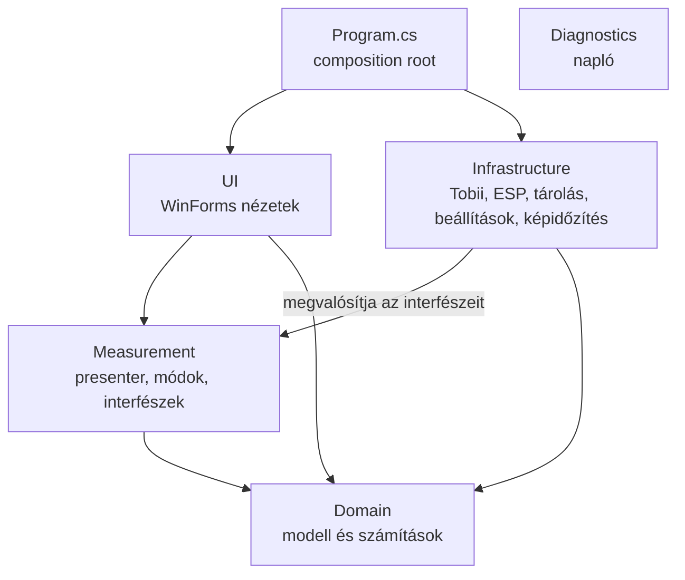
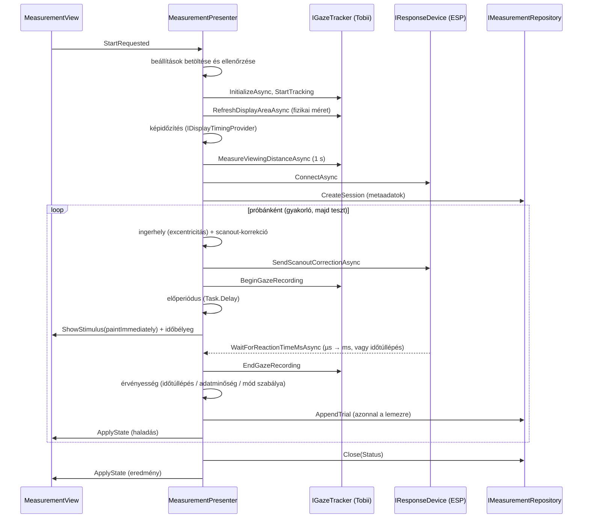

# Fejlesztői dokumentáció

## 1. Rétegek

A mappák a névtereknek felelnek meg (`ReactionTimeMeasurementApp.<Mappa>`).



| Réteg | Felelősség | Nem függ tőle |
|---|---|---|
| **Domain** | eredmények (`MeasurementResult`, `MeasurementSessionResult`, `ReactionTimeSummary`), beállítások (`ExperimentSettings`), próbaterv (`TrialSchedule`, `ForeperiodSampler`), látószög (`StageVisualSpace`), scanout-képlet (`ScanoutTrialParameters`, `ScanoutGeometry`), tekintetfelvétel (`TrialGazeRecording`) | WinForms, hardver, fájlrendszer |
| **Measurement** | a mérés menete (`MeasurementPresenter`), a nézet szerződése (`IMeasurementView`), a mérési módok (`IMeasurementMode`), a külső függőségek interfészei (`Abstractions.cs`) | WinForms, konkrét hardver |
| **Infrastructure** | `TobiiService`, `EspResponseDevice(Connector)` + `Serial`, `MeasurementRepository` + `MeasurementSessionWriter`, `ExperimentSettingsStore`, `DisplayTimingReader`, `AppPaths`, `AppOptions` | UI |
| **UI** | `MainMenu`, `MenuView`, `CalibrationView`, `MeasurementView`, `StatisticsView`, `ErrorPopup` és a rajzolási segédek | Infrastructure |
| **Diagnostics** | `Logger` | – |

## 2. MVP a mérési folyamatra

A mérés a **passzív nézet** változatot követi:

- A `MeasurementView` (UI) csak megjelenít és eseményeket továbbít
  (`StartRequested`, `LeaveRequested`, `AbortRequested`, `Closed`). Nem hoz döntést.
- A `MeasurementPresenter` (Measurement) minden döntést meghoz. Kiszámolja a
  nézet teljes állapotát (`MeasurementViewState`: gombfelirat, instrukció,
  haladás, fut-e a mérés), és az `ApplyState`-tel átadja. Az ingert a
  `ShowStimulus` mutatja meg.
- A két mérési mód közti különbséget stratégiaobjektumok adják
  (`NormalMeasurementMode`, `PeripheralMeasurementMode`): szövegek,
  beállításszakasz, mód-specifikus ellenőrzés és a tekintet alapú
  érvényességi szabály. A nézet és a presenter mindkét módnál ugyanaz.

A presenter nem hivatkozik WinForms-típusra (csak a `System.Drawing`
geometriai típusaira), ezért hamis nézettel és hamis hardverrel is futtatható.

## 3. Függőséginjektálás

Konstruktoros injektálás, konténer nélkül („pure DI”). Minden objektum a
`Program.Main`-ben jön létre (composition root):

```text
AppPaths ─┬─> Logger.Initialize
          ├─> MeasurementRepository ─┐
          └─> ExperimentSettingsStore ┤
TobiiService (IGazeTracker, ICalibrationService) ┤
EspResponseDeviceConnector ─┤
DisplayTimingReader ────────┴─> AppDependencies ─> MainMenu ─┬─> CalibrationView(ICalibrationService)
                                                              ├─> StatisticsView(IMeasurementRepository)
                                                              └─> MeasurementView + MeasurementPresenter(…)
```

A felület csak interfészeket lát. Szándékosan statikus maradt:

- a `Logger`, mert a naplózás minden rétegen átívelő feladat (a helyét a
  composition root adja meg);
- az `ErrorPopup`, a `UiResourceCache` és a `ViewBackgroundStyler`, amelyek
  UI-rétegbeli segédek és gyorsítótárak.

## 4. Egy mérés menete



A próbák ütemezését a `TrialSchedule` végzi: gyakorló próbák, majd tesztpróbák
addig, amíg össze nem gyűlik a kívánt számú érvényes (legfeljebb
`MaxTestAttempts`). A munkamenet állapota `Completed`, `AttemptLimitReached`
vagy `Aborted` lehet. Ha a fájlban nincs lezáró sor, az `Interrupted`
állapotot jelent.

## 5. Szálkezelés

- A nézet eseményei és a mérés előkészítése (`StartAsync`) a UI-szálon futnak;
  az `await`-ek után is oda térnek vissza (WinForms szinkronizációs kontextus).
- A próbák ciklusa (`RunMeasurementLoopAsync`) háttérszálon fut
  (`ConfigureAwait(false)`). Minden nézet- és szemkövető-állapotot érintő
  műveletet az `IMeasurementView.InvokeAsync`-kal a UI-szálra küld.
- Az inger kirajzolása és az időbélyeg egyetlen UI-szálas műveletben
  történik: előbb a szinkron rajzolás (`Update()`), utána rögtön az időbélyeg.
- A Tobii mintái a Tobii SDK saját szálán érkeznek; a felvétel zárolva bővül.
- A nézet eseménykezelői `async void` módon futnak, ezért a presenter minden
  kivételt elkap és naplóz (`RunSafelyAsync`). Ha a nézet időközben megszűnt,
  a frissítése semmit nem csinál.

## 6. Időzítés és geometria

- **Egy képkocka:** az inger és a fotodióda-jelző egy dupla pufferelt
  felületre, egyetlen rajzolással kerül ki, így ugyanabban a képkockában
  jelenik meg.
- **Scanout-korrekció:** `(Δy) × (aktív sor / asztalmagasság) × (képidő /
  összes sor)`. A pontos, tört frekvenciát és a holtidős sorszámot a
  `QueryDisplayConfig` adja. Részletek és feltevések:
  [SCANOUT_PROTOCOL.md](SCANOUT_PROTOCOL.md).
- **Látószög:** a pixelsűrűség a Tobii display area fizikai méretéből jön, a
  nézési távolság a szem helyzetéből (a kijelző síkjától mért merőleges
  távolság, medián). A `StageVisualSpace` a szemet a fixációs kereszttel
  szemben feltételezi.
- **DPI:** az alkalmazás PerMonitorV2 módban fut, így minden koordináta
  fizikai képpontban értendő, bármelyik monitoron.

## 7. Bővítési pontok

| Feladat | Teendő |
|---|---|
| Új mérési mód (pl. más tekintetszabály) | új `IMeasurementMode` megvalósítás, egy új `ModeSettings` szakasz az `ExperimentSettings`-ben, és egy menüpont / `ViewKey` a `MainMenu`-ben |
| Más válaszeszköz (pl. másik mikrokontroller) | új `IResponseDevice` + `IResponseDeviceConnector`, és csere a composition rootban |
| Más adattárolás (pl. adatbázis) | új `IMeasurementRepository` + `IMeasurementSessionWriter` |
| Más szemkövető | új `IGazeTracker` (és `ICalibrationService`) megvalósítás |

## 8. Tesztelhetőség

A presenter minden külső függősége interfész, ezért hamis objektumokkal
végponttól végpontig futtatható. A fejlesztés során így ellenőriztük a
gyakorló próbákat, az időtúllépés utáni ismétlést, a tekintethibát, a
próbálkozási korlátot, a megszakítást és a hibás beállításfájlt. A tiszta
Domain-logika (próbaterv, előperiódus-eloszlás, látószög, scanout-képlet,
CSV-mentés és -beolvasás) külön is tesztelhető.

> **TODO:** a repóban még nincs automatizált tesztprojekt (xUnit/NUnit). A
> fenti forgatókönyveket érdemes egy `ReactionTimeMeasurementApp.Tests`
> projektbe felvenni, és CI-ban futtatni.

## 9. Konvenciók

- Az azonosítók angolok, a kommentek és a felületi szövegek magyarok, ékezettel.
- A kommentek a jelenlegi működést és a döntések okát írják le. A
  változástörténet a commit-üzenetekbe tartozik.
- A nullable referenciatípusok be vannak kapcsolva, a build figyelmeztetés
  nélkül fordul.
- A felhasználónak szóló, nem programhiba jellegű problémákat a
  `MeasurementSetupException` jelzi, ezek hibaüzenetként jelennek meg.
